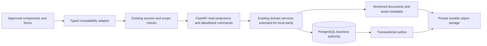

# 23 - Backend architecture

Stage 3 design proposal, 2026-10-21. **Extend the existing FastAPI/SQLAlchemy/psycopg/Alembic backend candidate; do not replace it.** Frontend candidate is Prem-dev-fbb-Go21 at a315448ce8c3f8f86026b58c18a2231bb3e5e9a7; backend candidate is prem-dev-fbb-backend at 50c8aab1766b61c914e2829b460bfd1697723ec2. The final authentication instruction explicitly approves the frontend SHA; backend and demo dataset remain baseline candidates. Earlier provisional direction is not final architecture, financial, import or deployment approval.

Reviewed the discovery/data/roles/workflow/contracts and risk evidence, especially 16?22. AGENTS.md and Graft were consulted. Referenced docs/agents/domain.md and docs/agents/issue-tracker.md are absent; no replacement instructions or issue creation is inferred. CONTEXT.md contains older list-view design notes; the user's UI freeze takes precedence. No source/config/tests/database were changed.

## ARCH-01 - System boundary

Keep one application/service deployment and the existing database stack. No microservices, new ORM, message broker or frontend state framework is required. The outbox can be processed by the same codebase in a worker process. External communications remain simulated until separately approved. Asset storage vendor/region/retention is unresolved; a storage interface allows private object storage or a backed-up private filesystem without affecting components.

## ARCH-02 - Module disposition

| Existing module/foundation | Classification | Required extension / preserved invariant |
|---|---|---|
| database.py, config.py, Alembic | REUSABLE WITH MODIFICATION | Runtime principal without superuser/BYPASSRLS, separate migration execution, verified candidate lineage; no automatic production startup upgrade |
| auth.py, tenancy.py, database_auth.py | REQUIRES MODIFICATION | One shared manual/dropdown credential endpoint and persistent cookie sessions in both environments; explicit dev fixture gating, source-ID bridge and seven-role rules |
| tenant_admin.py and session routes | REQUIRES MODIFICATION | Local roles/page grants/team rules, archive constraints, business settings/templates/import; no automatic invitations |
| intake.py | REQUIRES MODIFICATION | Customer/vehicle validation, booking date/type capacity and status, one atomic check-in/intake; local display fields retained |
| jobs.py | REQUIRES MODIFICATION | Job details/lifecycle/estimate commands, local owner/advisor and terminal predicates; reject additional remote-only completion requirements |
| execution.py, checklists.py, service_catalog.py | REQUIRES MODIFICATION | Existing task/QC/rework and checkbox cycles; catalog brands/segments and archived history |
| materials.py, inventory.py, procurement.py | REQUIRES MODIFICATION | Separate shortage demand from actual reservation; approved material locks, optional supplier quote, split/receipt/confirm/close semantics |
| finance.py | REQUIRES MODIFICATION | Proportional discount and per-line GST, stored historical values, atomic full payment/closure, local numbering/documents; native credit/refund exposure remains out of UI scope |
| followups.py, sales_crm.py | REQUIRES MODIFICATION / PARITY UNVERIFIED | Local filter/due-date/resolution/quotation behavior; preserve original result shapes and templates |
| media.py, evidence attachments | REQUIRES MODIFICATION | Decoded content validation plus job ownership/phase/terminal restrictions and durable metadata/bytes |
| Financial document generator | INCOMPLETE for approved UI | Existing generic heading/JSON output is not approved rendering; reuse versioning/history mechanics, preserve existing report HTML/PDF contract |
| Candidate demo importer/archive | REQUIRES MODIFICATION | Full 60-table operational mapping and immutable provenance; archive-only history is not automatic parity; no execution in Stage 3 |
| remote-* frontend workspaces | NOT SELECTED for integration | Existing files protected; reuse underlying transport where appropriate without replacing local screens |
| Developer/platform simulation | UNVERIFIED for real service adoption | Keep isolated simulated behavior; do not introduce real billing/invitations/support powers |

The 152 routes are all enumerated in 25. A six-route compatibility facade adds 148 allowlisted command contracts and read projections, translating into these services. This is a design count, not a claim that 148 independently new business services are necessary. Existing service functions should be extracted/reused only where needed to share the same transaction; no internal HTTP chaining.

## ARCH-03 - Command and query execution

Authenticate -> establish trusted membership/branch -> open scoped transaction -> acquire idempotency claim -> lock aggregates in documented order -> recheck role/status/version/quantities -> perform all writes/audit/snapshot metadata -> persist receipt -> commit -> respond with authorized projection. Do not report success before commit. Read-only projection uses a consistent snapshot; no arbitrary cross-role state dump. Response projection errors after commit are recovered by the same request key, never a second business write.

Use explicit row locking for scarce stock, status/financial aggregates and number allocator rows. All services must follow a deterministic order: tenant/branch admission or capacity key, business aggregate keys sorted by table class and ID, item IDs sorted, document sequence keys sorted, then dependent rows. If a workflow needs multiple classes, acquire its full required lock set in that order before mutation. Capacity uses a transaction-scoped advisory key or an existing capacity-row lock even when no booking exists; a count followed by insert without admission serialization is unsafe. Document uniqueness remains a database constraint. PostgreSQL lock behavior and deadlock handling are documented in [PostgreSQL 17 locking](https://www.postgresql.org/docs/17/explicit-locking.html).

Default writes may use READ COMMITTED with these explicit invariants/locks; range/absence predicates without a reliable lock key require SERIALIZABLE plus bounded whole-transaction retry. A serialization retry repeats all validation and uses the same idempotency key. Do not retry validation errors. Reads needing coherent multi-query totals use REPEATABLE READ. Ordinary sequences can advance on rollback; never promise gapless numbering from them. See [PostgreSQL isolation](https://www.postgresql.org/docs/17/transaction-iso.html).

## ARCH-04 - Financial and inventory transaction/test specifications

Each case runs in disposable PostgreSQL with pinned local golden data; additionally inject failure after every write, response loss after commit, duplicate key, stale version and two simultaneous actors. Assert both UI outcome and complete database effect/absence.

| ID / PAR | Atomic service operation and locks | Required assertions |
|---|---|---|
| SVC-01 / 16?17 | Intake/check-in: capacity/date/type, booking, customer/vehicle identity, visit/job/checklist/history | Two requests for final slot cannot overbook; same booking checked in twice returns one visit/job. Invalid intake leaves no partial master/job. Preserve override reason and actor. |
| SVC-02 / 02,04,11 | Estimate save/approve: job + estimate + lines + approval/snapshot | Mixed 100@18% and 100@0%, flat discount100 yields tax9,total109; fractional quantity/rate/rounding examples match local; no backend first-line discount allocation. Approved snapshot unchanged after later edits. |
| SVC-03 / 03,07 | Invoice save/create/void: job/invoice + selected lines/material claims + events/checklist/snapshot | Eligible local lines only; no duplicate billing claim. Preserve 52 headers/105 lines and all 51 discrepancy exceptions on import/read/unrelated edit. Pending/paid/void restrictions match local. |
| SVC-04 / 05?06 | Full payment and closure: job/invoice + active payment/claims + numbers + receipt/gatepass/ack/checklist | Completed eligible job with reminder produces exactly one full payment, receipt, gate pass, acknowledgement and CLOSED. Failure rolls everything back. No partial payment/two-step handover introduced. Void/correction terminal policy requires FIN-03 approval. |
| SVC-05 / 08 | Document/request number allocation within creating command | Historical identifiers never change; concurrent allocation unique; same key same number. Tenant/branch/year/reset/gap convention pending FIN-04. Internal identity sequence is separate from printed number. |
| SVC-06 / 09?10 | Demand/request/re-request/release and material approval: job/request/approval, sorted stock items | Shortage can be requested without reservation; Store issue requires approval/state; no overdraw across jobs; issued/invoiced rows cannot bypass edit locks. Approval decisions and events atomic. |
| SVC-07 / 10 | Consume/return/waste/reverse: request + stock + movement/ledger | Sum constraints exactly local; zero-return acknowledgement and note requirements preserved. Duplicate return cannot inflate stock. Invoice claims prevent invalid material rewrites. |
| SVC-08 / 11?12 | Purchase approval/split: request/lines + supplier/item + child orders/provenance | Existing/new SKU approval without saved quotation remains possible when local input valid. New SKU starts zero. Multi-supplier failure leaves no partial order/SKU/status. Store cannot approve. |
| SVC-09 / 13 | PO receipt/confirmation/close: PO + receipt/confirmation lines + sorted item balances/ledger | Order10, receive6+4, accept8/reject2 with reason; stock changes only on close by8 once. Overreceipt, missing confirmation, replay and direct-inward bypass rejected. |
| SVC-10 / 10,13 | Direct inward/revision/adjustment: purchase revision + item + ledger | Revisions apply correct approved deltas, preserve originals; no duplicate stock. Unrelated direct-inward path cannot bypass PO close rules. |
| SVC-11 / 14?15 | Job/task/QC/checklist: job + task/cycle/history | All allowed/forbidden edges for seven roles; local manager limitation preserved; failed QC/rework/pass follows local evidence, no added remote gates. |
| SVC-12 / 19?22 | Template activation and document/media freeze: template/category + source aggregate + ready asset | One active template/category; eight defaults/six active categories. Settings changes do not rewrite historical output. Permission/phase/signature errors create no attachment. |

FIN-01 through FIN-04 remain approval gates. Source local arithmetic is provisional; do not call it legally certified tax behavior. No historic equality CHECK or recalculation migration is proposed.

## ARCH-05 - Schema, media and migration dependencies

Schema proposal 24 retains candidate infrastructure and adds required compatibility columns/entities rather than archiving away visible history. Migration lineage must be verified from 50c8aab: old checkout migrations were rewritten/reparented; direct stamp/upgrade is not safe. Fresh replay and existing-head bridge are separate work packages. Import design 27 preserves every source row and conflict; current browser data is unknown.

Store document values/template/company assets as versioned immutable snapshots at the local lifecycle event. Prefer private durable object bytes with PostgreSQL metadata. Stage upload before metadata transaction, commit READY reference only after verified checksum; keep pending objects invisible. Outbox finalizes derivative work, retries idempotently, and deletes abandoned staged objects only after retention approval. Database rollback cannot undo an already uploaded object, so delayed cleanup is required. Do not regenerate absent historical artifacts and label them original. Retain current HTML/PDF layout/rendering helpers initially.

## ARCH-06 - Observability and errors

Structured logs: request ID, operation, tenant/branch scoped IDs, actor ID, duration, outcome/error code, idempotency replay/conflict and aggregate version. Exclude passwords/tokens/cookies, raw uploads, complete customer records and financial document contents. Commit business audit rows with effects; security denials use a separate redacted event path so failed business transactions do not erase denial evidence. Record before/after relevant fields, reason and source provenance for state/money/stock/admin changes. Retention and audit export access need owner approval.

Track error rate, latency, lock wait/deadlock/serialization retry, duplicate replay, stock rejection, document availability, outbox backlog and import exceptions. Map stable errors in 25 to existing UI channels. No new notification UI, real sends or workflow is introduced. Design approval does not authorize deployment or implementation.

## AUTH-DEC-01 update

[26](26-AUTHENTICATION-RBAC-DESIGN.md) supersedes earlier separate-mode suggestions: one authentication/session architecture; the development dropdown only fills credentials. Persistent sessions survive refresh/restart while valid, and backend expiry/revocation/CSRF/logout are mandatory. No dropdown-derived account whitelist. Production excludes credential fixtures; publicly accessible development requires additional access restriction. User-edit password semantics remain separately pending.
