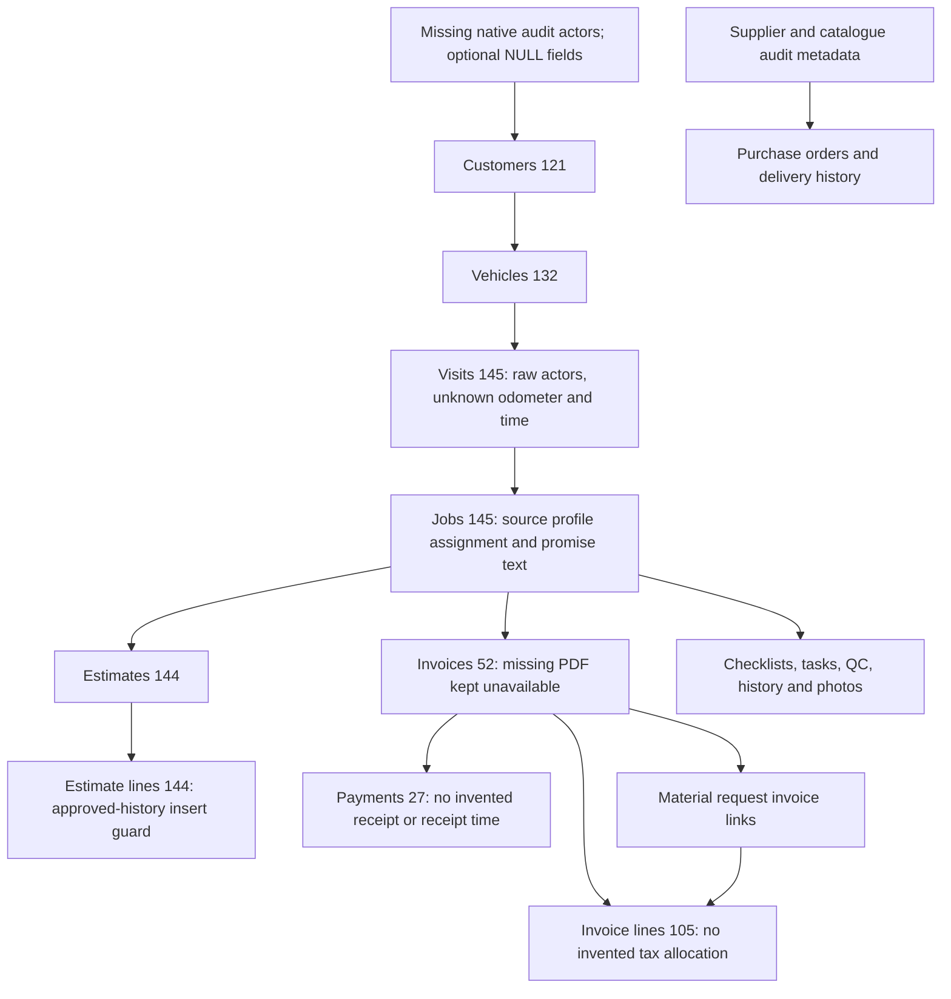

# 40 — Business import unblocking

Implemented and tested on disposable PostgreSQL only. **3,174 business records imported; 67 remain quarantined. Migration is incomplete.** No frontend integration, production/staging connection, deployment, commit or push occurred.

## Results

| Outcome | Previous rehearsal | Improved rehearsal |
|---|---:|---:|
| Source records | 3,241 | 3,241 |
| Promoted business records | 12 | 3,174 |
| Quarantined | 3,229 | 67 |
| Failed/unaccounted | 0 | 0 |
| Duplicate source identities | 0 | 0 |

The increase is **3,162 business records**. Complete source custody still contains all 3,241 original records, including promoted rows; custody is not counted as business migration. Two disposable scope rows are additional metadata. All 60 source entities reconcile separately, including empty tables: [entity counts](stage4c2-entity-counts.json.md), [reconciliation](stage4c2-reconciliation.json.md), [per-record ledger](stage4c2-record-ledger.json.md).

| Operational entity | Business rows |
|---|---:|
| Customers | 121 |
| Vehicles | 132 |
| Visits / jobs | 145 / 145 |
| Estimates / estimate lines | 144 / 144 |
| Invoices / invoice lines | 52 / 105 |
| Payments | 27 |
| Inventory catalogue / suppliers | 4 / 2 |
| Purchase orders / lines | 2 / 3 |
| Purchase receipt headers / lines / confirmations | 2 / 3 / 3 |
| Material requests / legacy movements | 117 / 3 |
| Photo metadata | 289 |
| Legacy receipts / gate passes | 27 / 27 |

Photo metadata and legacy receipt/gate-pass rows are business records, **not recovered image/PDF bytes**. No historical artifact was fabricated. No platform authentication users were created.

## Root causes and dependency graph

The source relationship inventory has no missing nonzero parent IDs. Most apparent missing parents were themselves quarantined due to native audit requirements, nullability, identity types or missing artifact prerequisites. Retrying foreign keys alone could not resolve these roots.

[Machine-readable dependency graph](stage4c2-dependencies.json.md) records every non-NULL source relationship with source identity, actual parent, A/B/C classification, direct root groups and distinct transitive impact. Impacts overlap and must not be added. For example, missing `created_by` affects 1,597 rows directly and reaches 3,219 quarantined rows through source dependencies; unknown customer addresses directly affect 120 customers and reach 3,182 records. Source edges describe dependency potential, not a claim that resolving one root alone promotes every descendant.

Classification and implementation:

| Class | Relationship/field | Treatment |
|---|---|---|
| A — essential | Customer, vehicle, visit, job, estimate, invoice, payment, inventory and purchase parent links | Preserve source IDs and all existing scoped/same-job foreign keys; retry only after successful parent promotion. No absent parent fabricated or FK disabled. |
| B — historical metadata | Recorded nonzero historical user references | Preserve source profile IDs in new scoped `historical_*` FKs. Native platform-user references remain NULL where no real account mapping exists; no login/membership authorization is implied. |
| B — historical metadata | Unrecorded audit creators/updaters, optional address/engine/odometer/fuel details | Explicit NULL preservation, limited to custody-bound imported history. Native required fields retain equivalent CHECK requirements. |
| B — historical metadata | Naive timestamps and relative promises | Preserve exact raw text in `historical_values` and full custody; do not infer timezone or import-time dates. Explicit-offset timestamps retain their instants. |
| B — unavailable artifacts | Invoice/receipt PDFs, photo bytes, unrecorded line tax allocations and estimate revision metadata | Native fields remain unavailable/NULL only for verified history. Original financial values, statuses, paths and source availability flags remain exact; separate metadata states physical artifact availability. |
| B — documented sentinel | Three non-job `STOCK_IN` material movements | Preserve source zero in `legacy_job_card_id` and custody; use NULL only for the absent job link. No stock reposting. |
| C — unresolved | Actor-zero checklist records, unlinked bookings, department/membership identity policy, stock semantic projection | Retain quarantine as detailed below. |

Deterministic corrections also include native follow-up/QC status projections, supplier mobile from source phone, exact unit/rate conversion for invoice lines, and per-parent line positions ordered by preserved source IDs. No invoice header or line total is recalculated. Estimate revision stays unknown rather than inventing historical revision numbers.

## Implementation and safeguards

New Alembic revision `20261021_0037` follows unchanged 0036. The chain now has **38 revisions and one head**. There are still 106 public tables and two custody tables.

The migration adds custody identity fields, historical metadata, and scoped historical profile references on the affected tables. Selected native NOT NULL fields become conditional checks: a native row still requires the field; a historical exception requires a matching custody identity, exact source/target and disposable scope, an unfinished import run, and the disposable owner role. Imported rows are immutable. Runtime-role attempts to claim history fail. Essential business NOT NULL fields and every pre-existing named CHECK, FK and unique constraint remain intact. Upgrade refuses populated custody, and downgrade refuses populated affected tables.

The approved-estimate trigger initially rejected restoring approved estimate lines. Its new exception accepts INSERT only for an owner-run, unfinished import with a matching custody line and parent ID. It does not permit normal approved-estimate edits, post-import appends, or global trigger disabling. Regression tests exercise those denials.

Importer changes retain lossless custody, source hashes, source-ID mappings, transactions, savepoints, dependency retries, sequence synchronization, policy drift rejection and snapshot verification. Primary-key catalog lookups are cached per table. SQLAlchemy parameter display is suppressed on errors. No original SQLite or historical migration file was edited.

Files changed/added:

- `backend/import-rehearsal/importer.py`, `run.py`, `README.md` — projection, new migration head, verification and operator instructions.
- `history_policy.py`, `versions/20261021_0037_historical_import.py` — explicit policy and frozen additive migration contract.
- `test_business_coverage.py` — 12 business-coverage, preservation, constraint and security tests.
- `test_rehearsal.py` — only the expected migration-head assertion changed; existing behavioral tests remain intact.
- `analyze_dependencies.py`, `verify_protection.py` — reproducible dependency analysis and file protection verification.
- This report, README index, and `stage4c2-*` evidence files.

**Frontend files modified: none.** No approved UI or workflow implementation was changed. Native services and future adapters must support historical availability and immutable imported rows before frontend integration; current application-route/workflow parity is not claimed.

## Execution and verification

Final project: `workshopos-import-unblock-03`; database: `stage4c_rehearsal`. This project was created with a fresh dedicated volume and internal network; PostgreSQL has no published port. Original rehearsal resources were not modified or removed. The first attempted run rolled back on a projection error. The next identified the approved-estimate trigger blocker and rolled back. A subsequent intermediate rehearsal promoted 3,133 rows; stronger coverage tests caught remaining raw timestamp cases. The final fresh run completed with the results above.

Reproduce/idempotently verify using the [operator README](../../backend/import-rehearsal/README.md). Do not reuse the earlier 12-record project with the new policy; drift and populated-custody guards deliberately refuse it.

**36 passed, 0 failed, 0 errors, 0 skipped**, with one dependency deprecation warning ([JUnit evidence](stage4c2-tests.xml.md)). Verified clean lineage replay, empty downgrade/re-upgrade, repeated upgrade, repeated import without duplicates, every promoted source projection, every entity count and ID set, complete lossless custody, referential integrity, native-field requirements, runtime-role denial, closed-run/approved-estimate immutability, exact financial business values, all zero occurrences and identity sequences. No frontend/browser tests were rerun.

Isolated in-process FastAPI tests select real PostgreSQL business tables under the explicit scope:

| API fixture read | HTTP | Returned records |
|---|---:|---:|
| Customers | 200 | 121 |
| Vehicles | 200 | 132 |
| Jobs | 200 | 145 |
| Invoices | 200 | 52 |

[API evidence](stage4c2-api-reads.json.md). These routes are test fixtures, not deployed application routes, and expose no custody payloads. Authentication/application-route acceptance remains outside this package.

All 52 invoice headers, 105 lines and 27 payments retain original stored values and associations in business tables and exact original representations in custody. All **51 historical subtotal discrepancies remain unchanged** ([financial evidence](stage4c2-financial-preservation.json.md)). No tax allocation, financial correction, stock reposting, receipt or PDF generation occurred.

[Final file protection](stage4c2-protection.json.md) verifies all **115 protected files, 94 screenshots and eight SQLite copies** against prior hashes. Branch remains `Prem-dev-fbb-Go21`, HEAD `a315448ce8c3f8f86026b58c18a2231bb3e5e9a7`. Existing uncommitted work remains. Runtime visual behavior was not retested and remains unverified.

## Remaining 67 records and next boundary

| Records | Remaining root blocker | Required next decision/work |
|---:|---|---|
| 52 checklist items | `checked_by=0` has no proven human | Explicit unattributed/system historical actor disposition; retain original zero. |
| 2 bookings + 2 events | Bookings have no source customer/vehicle links; native booking requires both; native actor mapping is also unavailable | Review legacy unlinked booking representation without inventing customer/vehicle parents. Events depend on those bookings. |
| 2 departments + 2 department-manager links | Integer department identities versus native UUIDs and real membership IDs | Approve stable department identity mapping and genuine membership provisioning policy. Do not fabricate login accounts. |
| 4 stock-ledger + 3 stock-inward rows | Source `po-closure-inward` signed quantities versus native posting semantics; historical actor/time and ledger prerequisites | Review explicit historical stock representation and linkage without reposting, reversing signs, or assuming valuation. All source quantities remain in custody; inventory snapshots are imported. |

Browser-only records remain unknown and untouched. These 67 records, unavailable artifact bytes, native writer compatibility, full authentication/workflow regression, and frontend integration prevent complete migration or deployment readiness. **Stop here after implementation/testing; the next action is a separately scoped resolution of these remaining policies.**
